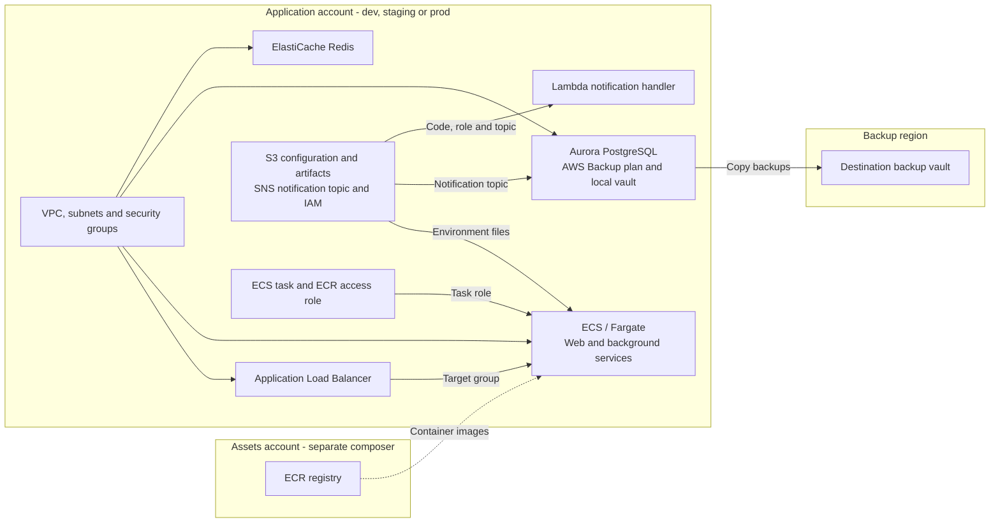
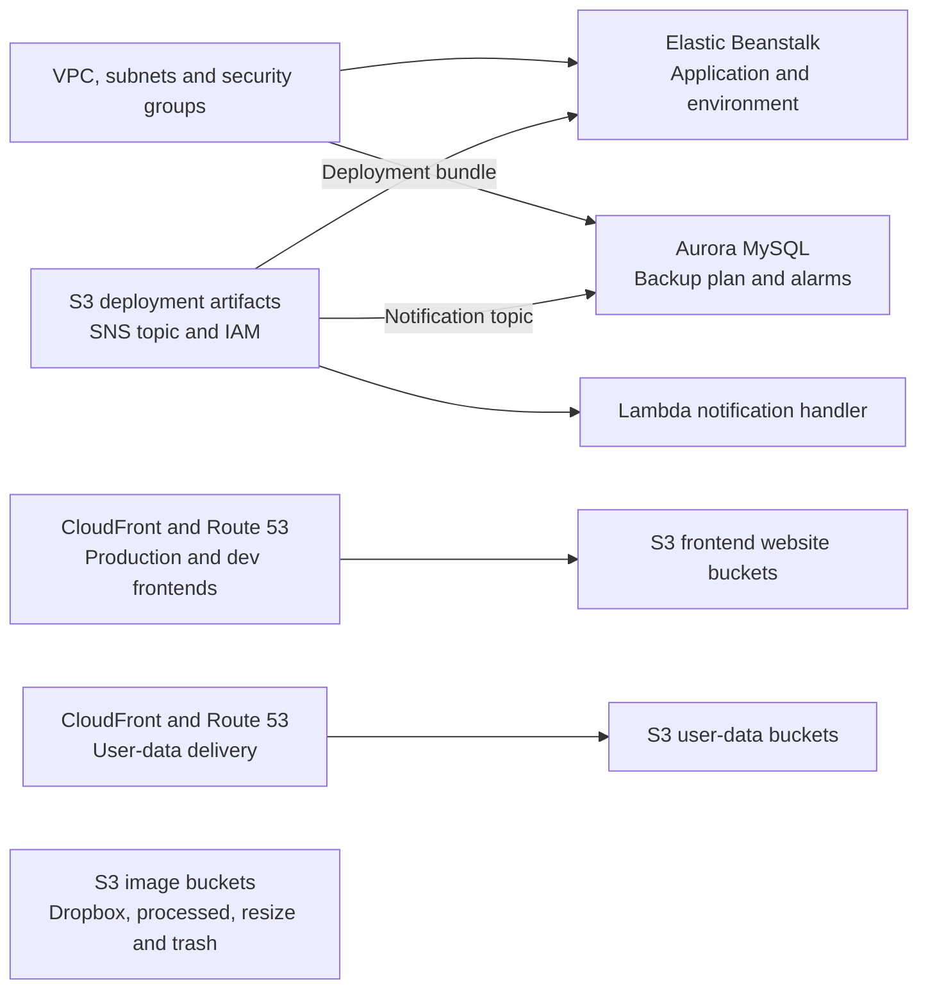

# RonSijm.FluidHumidifier

[RonSijm.Humidifier](https://github.com/RonSijm/RonSijm.Humidifier) gives you strongly typed C# objects for AWS CloudFormation. It is deliberately quite close to the CloudFormation resource specification: create a `Stack`, create some resources, set their properties, and add them to the stack.

That works, but larger templates tend to grow a lot of object initializers, nested lists, repeated `stack.Add(...)` calls, and string-based references between resources.

FluidHumidifier adds a composition layer on top of that model:

- A generated factory for each Humidifier resource and sub-resource.
- A `StackFactory` with discoverable `With...` methods for adding resources.
- Fluent `With...` methods for nested CloudFormation properties.
- Factory-aware `Ref`, `GetAtt`, name, ARN, and list helpers.
- A decorator pipeline for applying naming, tagging, encryption, and other conventions in one place.
- Higher-level helpers for recurring structures such as IAM policy documents, VPC subnets, and security-group traffic.
- Optional stack and environment composer types for splitting a larger infrastructure project into smaller pieces.

The result is still a normal `Humidifier.Stack` containing normal Humidifier resources. FluidHumidifier does not introduce a second CloudFormation model and it does not replace the Humidifier serializer.

The name is basically a fluent/fluid joke on top of Humidifier. Explaining it has not improved it.

The stable implementation remains in `src` and targets .NET 10 (`0.1.<spec>`).
The typed union implementation lives in `src-dotnet11` and targets .NET 11 preview (`0.2.<spec>-dotnet11`).
Both use the package ID `RonSijm.FluidHumidifier`; prerelease versions do not mark stable versions as preview.
Each track references the corresponding Humidifier source tree or NuGet version.

Run `dotnet` from the chosen source directory to select its pinned SDK. Build a local package with
`dotnet pack RonSijm.FluidHumidifier -c Release -p:GeneratePackageOnBuild=false -o ../../packages`.
Version files are separate for each track; `src-dotnet11/version-suffix.txt` sets the .NET 11 package suffix to `dotnet11`.
The publishing and upstream generation workflows process both tracks.

To release a new major or minor version without an upstream AWS update, change `version.txt`
in the relevant source directory and push to `main`. Publishing checks the complete NuGet
version, including `-dotnet11` where applicable. Scheduled and manual update runs also check
for unpublished versions even when no upstream files change; published versions are skipped.

Install the .NET 11 version with `dotnet add package RonSijm.FluidHumidifier --version 0.2.26700-dotnet11`.

The API notes below and the maintained examples describe `src-dotnet11`, which uses the preview C# compiler pinned in its `global.json` for native unions. Set `<LangVersion>preview</LangVersion>` in consuming projects. Resource properties accept their literal type or a `BaseFunction`; intrinsic functions and factory references remain assignable directly.

For collections containing expressions, use `List<Union<T, BaseFunction>>` or `Union<T, BaseFunction>[]`. Ordinary lists and arrays of `T` also work, and a `BaseFunction` can supply the whole collection. Use `GetLiteral()` and `GetItems()` from `RonSijm.FluidHumidifier.Features.Helpers` when a decorator needs to inspect literal values locally; they reject deferred expressions. `Fn.JoinList(separator, values)` joins a wrapped string list without adding an extra array. The examples use `Fn.Literal(value)` where preserving their original JSON representation requires a value different from the schema's literal type, including integer formatting for schema `Double` properties.

## Complete application examples

The [NimbusFactory examples](Examples/README.md) generate infrastructure for two fictional applications. Both include sample configuration and snapshot tests, and their CLIs write CloudFormation JSON, batch deployment scripts, and GitHub workflows.

### AppleStore: a container application across accounts and regions

[AppleStore](Examples/AppleStore.AWS.NimbusFactory) is the larger example. Its default CLI generates development, staging, and production environments from the same composers.

It includes:

- A VPC, subnets, routing, and security groups shared by the application stacks.
- An application load balancer and ECS/Fargate services for the web application, background jobs, and other workers.
- Aurora PostgreSQL and an ElastiCache Redis replication group.
- S3 buckets for deployment artifacts, container environment files, and static assets, with CloudFront distributions for asset delivery.
- AWS Backup plans, a local backup vault, and a destination vault in another region.
- IAM deployment roles, SNS/Lambda notifications, and logging resources.
- A separate assets-account composer containing an ECR registry and permissions for other accounts to pull images. The default CLI output list currently includes the application environments; the assets environment is available in its own composer.

The diagram shows the main stack relationships. Arrows describe imports or the labeled operation:



Start with the [environment composer](Examples/AppleStore.AWS.NimbusFactory/AppleStore.AWS.NimbusFactory.CLI/Features/OTAPAccounts/OTAPEnvironmentComposer/OTAPEnvironmentComposer.cs) to see stack ordering and exports. The [database composer](Examples/AppleStore.AWS.NimbusFactory/AppleStore.AWS.NimbusFactory.CLI/Features/OTAPAccounts/StacksForOTAP/DatabaseStack/DatabaseStackComposer.cs) shows how the database, backup plan, monitoring role, alarms, and destination vault fit together.

### FruitVendor: Beanstalk, a frontend, and image storage

[FruitVendor](Examples/FruitVendor.AWS.NimbusFactory) generates one `fruitvendor-prod` environment. It uses smaller stacks for:

- A VPC and shared network resources.
- An Elastic Beanstalk application and environment, including its instance profile, deployment bundle, scaling options, and load balancer configuration.
- An Aurora MySQL database, backup plan, and backup/restore alarms.
- Production and development frontend buckets with website configuration, CloudFront distributions, and Route 53 records.
- Image dropbox, processed, resize, and trash buckets, plus two user-data buckets with CloudFront delivery. The image-processing stack creates storage and delivery resources; it does not create a resizing worker.
- Deployment IAM roles, shared artifacts, and SNS/Lambda notifications.



The [environment composer](Examples/FruitVendor.AWS.NimbusFactory/FruitVendor.AWS.NimbusFactory.CLI/Features/OTAPAccounts/OTAPEnvironmentComposer/OTAPEnvironmentComposer.cs) is the entry point. Look at [S3Helper](Examples/FruitVendor.AWS.NimbusFactory/FruitVendor.AWS.NimbusFactory.CLI/Features/Helpers/S3Helper.cs) and the [frontend composer](Examples/FruitVendor.AWS.NimbusFactory/FruitVendor.AWS.NimbusFactory.CLI/Features/OTAPAccounts/StacksForOTAP/FrontendStack/FrontendStackComposer.cs) for a concrete example of reusing a bucket setup across several resources.

The [examples README](Examples/README.md) contains build, test, and generation commands. Running the generators writes files; deployment happens when you run the generated deployment steps with your own configuration.

## What does this add over Humidifier?

Humidifier lets you write this:

```csharp
var stack = new Stack
{
    Description = "Application network"
};

var vpc = new Humidifier.EC2.VPC
{
    GivenName = "ApplicationVpc",
    CidrBlock = "10.0.0.0/16",
    EnableDnsHostnames = true,
    EnableDnsSupport = true
};

stack.Add(vpc);

stack.Add(new Humidifier.EC2.SecurityGroup
{
    GivenName = "WebSecurityGroup",
    GroupDescription = "HTTP access",
    VpcId = Fn.Ref(vpc.ResourceName)
});
```

FluidHumidifier lets you describe the same relationship through factories:

```csharp
var environment = new EnvironmentFactory(
    new EnvironmentConfig("dev", "123456789012", "eu-west-1"))
{
    Decorator = new DecoratorOrchestrator([])
};

var stack = environment.AddStack("Application Network");
stack.Stack.Name = "ApplicationNetwork";
stack.Stack.Description = "Application network";

var vpc = stack.WithVPC("ApplicationVpc", result =>
{
    result.CidrBlock = "10.0.0.0/16";
    result.EnableDnsHostnames = true;
    result.EnableDnsSupport = true;
});

stack.WithEC2SecurityGroup("WebSecurityGroup", result =>
{
    result.GroupDescription = "HTTP access";
    result.VpcId = vpc.FFnREF();
});

Stack result = environment.Build().Single();
```

There are three practical differences here:

- `WithVPC` and `WithEC2SecurityGroup` register the resources with the stack. You do not separately construct and add them.
- The configuration lambda still exposes the original Humidifier type. You keep the normal CloudFormation properties instead of learning another property model.
- `vpc.FFnREF()` holds a reference to the factory. It resolves the resource's final logical name after the factory and any decorators have done their work.

That last bit matters once names are produced by conventions rather than hard-coded strings.

### Apply the rule once

The larger reason to use FluidHumidifier shows up when you have several stacks. Creating the next resource is easy. Remembering every naming, tagging, encryption, and access rule each time is tedious, and eventually someone forgets one.

The decorator pipeline supports an aspect oriented style of infrastructure composition:

- Stack composers describe the resources needed by the application.
- Decorators describe concerns that apply across those resources, such as choosing the environment's KMS key or adding tags.
- The build pipeline applies registered decorators to matching resources, including resources created through reusable helpers.

These aspects run while the CloudFormation model is built. A decorator can match a resource interface shared by many AWS services, so the convention can follow the capability instead of being repeated for every concrete resource class.

#### KMS keys are a good example

AppleStore has a database cluster, Redis, ECS log groups, and an ECR registry. Several of those resources accept a KMS key, but they do not all expose it in the same way.

With plain Humidifier, you can set the key on every object initializer. That means repeating the selection logic and remembering to include it when you add another encrypted resource. A missed assignment may still produce valid C# and a CloudFormation template, just without the key your project expects.

FluidHumidifier includes conventions you can register once:

```csharp
using RonSijm.FluidHumidifier.Features.Decorating.Decorators.ECR;
using RonSijm.FluidHumidifier.Features.Decorating.Decorators.Interfaces;
using RonSijm.FluidHumidifier.Features.Decorating.Interfaces;

IDecorator[] encryptionConventions =
[
    new AddEncryptionWhenPossibleToIHaveKmsKeyIdDecorator(),
    new AddEncryptionWhenPossibleToIHaveCapitalKMSKeyIdDecorator(),
    new AddEncryptionToRepositoryDecorator()
];
```

Pass that collection to the `DecoratorOrchestrator` assigned to your `EnvironmentFactory`. The first two decorators target Humidifier's `IHaveKmsKeyId` and `IHaveKMSKeyId` interfaces. They apply the same selection rule to compatible resources such as Aurora clusters, Redis replication groups, and CloudWatch log groups. The ECR decorator handles the repository's nested `EncryptionConfiguration` instead.

The built-in rule selects this alias using the current environment and CloudFormation region/account:

```text
arn:aws:kms:${AWS::Region}:${AWS::AccountId}:alias/KMS-{EnvironmentName}-CMK
```

The alias and key permissions need to exist in the target account and region. These decorators assign the key; resource-specific switches such as `StorageEncrypted` and `AtRestEncryptionEnabled` still belong in the resource configuration. Backup vaults use a different property, `EncryptionKeyArn`, which the demos configure explicitly.

One detail worth knowing: these particular decorators assign their values even if you already supplied a key. If your project needs per-resource exceptions or a different selection rule, change the registered decorators to express that policy. They are ordinary C# classes with a matching rule, an execution phase, and a rank.

You now have one place to review the KMS convention, and newly added matching resources go through the same pipeline.

#### Making an S3 bucket usually means more than making an S3 bucket

The examples have buckets for environment files, deployments, frontends, and image storage. Each use has its own collection of settings: ownership, public access, versioning, encryption, lifecycle rules, website documents, and sometimes a bucket policy, CloudFront distribution, and DNS records.

Copying that setup for every bucket has the same problem as copying the KMS assignment. It is easy to update the helper in one stack and miss the copy in another.

There are two useful places to put those decisions:

- Use a decorator for a convention that should apply to matching buckets throughout the build. The library already includes `BucketNameToLowerDecorator` and `HaveTagsDecorator`; you can add your own decorators for your project's versioning, encryption, or lifecycle policy.
- Use a helper or composer for a particular kind of bucket and its related resources. FruitVendor's `S3Helper` configures public access, ownership, and optional website documents, then adds the policy, CloudFront distribution, certificate reference, and DNS records through separate helper calls.

For example, its frontend composer uses the same setup for both frontend buckets:

```csharp
var bucket = S3Helper.BucketWithPublicAccess(stack, bucketName, asWebsite: true);
S3Helper.WithPublicCloudFrontPolicy(stack, bucketName, bucket);
S3Helper.WithPublicCloudFront(stack, bucketName, Environment);
```

`S3Helper` belongs to the demo application. Its public access settings are an explicit choice in that example. You can build the equivalent helper for your own access pattern and reuse it wherever that kind of bucket is needed.

`WithS3Bucket(...)` itself only creates the factory. Versioning, encryption, and other project policies take effect when you configure them directly or register decorators that implement them. S3's nested encryption settings also need their own convention; the generic KMS-property decorators above do not cover them. The [custom S3 decorator example](#creating-your-own-decorator) below implements that convention.

#### What else do the examples show?

- Reuse the whole stack across environments. AppleStore runs the same composers for development, staging, and production with different `EnvironmentConfig` values. The decorator pipeline receives that context too.
- Keep network wiring together. The VPC composer groups subnets, route tables, ACL associations, and security-group rules, then exports the resources the database, cache, and application stacks need.
- Give stack boundaries a C# interface. `ExportModel` and `ImportModel` let composers exchange selected factories, and references resolve through the resulting resources. AppleStore's ECS composer consumes network, IAM, configuration, and load-balancer exports without recreating those stacks.
- Keep deployment metadata with the stack. The backup composer returns a `StackCreateResult` with its destination region, which the batch and GitHub workflow generators use for that deployment step.
- Review the generated result. The example snapshot tests serialize composed stacks, so a change to a shared rule can be checked in the resulting templates. The ECS tests also show supplying a dependency explicitly or resolving it from imports.

You can build helpers and conventions around vanilla Humidifier too. FluidHumidifier supplies the shared build lifecycle, decorator propagation, and factory references that connect those pieces. That becomes useful when a resource created deep inside a helper should receive the same rules as one declared directly in a stack.

## Installation

Add FluidHumidifier:

```powershell
dotnet add package RonSijm.FluidHumidifier
```

The compatible `RonSijm.Humidifier` package is installed automatically as a dependency.

If you also want to serialize the finished stack to CloudFormation JSON, add the Humidifier JSON package:

```powershell
dotnet add package RonSijm.Humidifier.Json
```

## A complete small example

This creates a VPC, a security group that refers to it, and a versioned S3 bucket:

```csharp
using Humidifier;
using Humidifier.Json.Serializer;
using RonSijm.FluidHumidifier.Factories;
using RonSijm.FluidHumidifier.Factories.Base;
using RonSijm.FluidHumidifier.Factories.EC2;
using RonSijm.FluidHumidifier.Factories.S3;
using RonSijm.FluidHumidifier.Features.Consumer;
using RonSijm.FluidHumidifier.Features.Factories.Base;

var environmentFactory = new EnvironmentFactory(
    new EnvironmentConfig(
        EnvironmentName: "dev",
        AWSAccountId: "123456789012",
        Region: "eu-west-1"))
{
    // The build pipeline always has a decorator orchestrator.
    // An empty one means: build the factories without extra conventions.
    Decorator = new DecoratorOrchestrator([])
};

var stackFactory = environmentFactory.AddStack("Application Infrastructure");
stackFactory.Stack.Name = "ApplicationInfrastructure";
stackFactory.Stack.Description = "Infrastructure for the application";

var vpc = stackFactory.WithVPC("ApplicationVpc", vpc =>
{
    vpc.CidrBlock = "10.0.0.0/16";
    vpc.EnableDnsHostnames = true;
    vpc.EnableDnsSupport = true;
});

var webSecurityGroup = stackFactory.WithEC2SecurityGroup("WebSecurityGroup", group =>
{
    group.GroupDescription = "Traffic for the web application";
    group.VpcId = vpc.FFnREF();
});

webSecurityGroup.AcceptTraffic(
    description: "HTTPS inbound",
    fromPort: 443);

var bucket = stackFactory.WithS3Bucket("application-assets");

bucket.WithVersioningConfiguration(versioning =>
{
    versioning.Status = "Enabled";
});

bucket.WithPublicAccessBlockConfiguration(access =>
{
    access.BlockPublicAcls = true;
    access.BlockPublicPolicy = true;
    access.IgnorePublicAcls = true;
    access.RestrictPublicBuckets = true;
});

var stack = environmentFactory.Build().Single();
var json = new JsonStackSerializer().Serialize(stack);

File.WriteAllText("application-infrastructure.json", json);
```

`Build()` is the boundary. Before it, you have a graph of factories. After it, you have the regular Humidifier object graph that can be inspected, tested, changed further, or serialized.

Start at `EnvironmentFactory`, even when you only need one stack and do not use environment-specific decorators. It is the root factory that propagates the decorator orchestrator into every nested factory before the graph is built. Constructing `StackFactory` directly happens to work for flat resources, but nested `With...` factories will not have that wiring.

## How the generated API maps to CloudFormation

The factory library is generated from the same AWS CloudFormation resource specification as Humidifier. The naming is intentionally predictable.

For example, `AWS::S3::Bucket` maps like this:

- `StackFactory.WithS3Bucket(...)` creates a `BucketFactory`.
- The lambda passed to `WithS3Bucket` configures a `Humidifier.S3.Bucket`.
- `Bucket.VersioningConfiguration` becomes `BucketFactory.WithVersioningConfiguration(...)`.
- `Bucket.PublicAccessBlockConfiguration` becomes `BucketFactory.WithPublicAccessBlockConfiguration(...)`.
- List properties use repeatable methods. Calling `WithInventoryConfigurations(...)` more than once appends more inventory configurations.

So a nested object initializer such as this:

```csharp
var bucket = new Humidifier.S3.Bucket
{
    GivenName = "application-assets",
    VersioningConfiguration = new Humidifier.S3.BucketTypes.VersioningConfiguration
    {
        Status = "Enabled"
    },
    PublicAccessBlockConfiguration = new Humidifier.S3.BucketTypes.PublicAccessBlockConfiguration
    {
        BlockPublicAcls = true,
        BlockPublicPolicy = true,
        IgnorePublicAcls = true,
        RestrictPublicBuckets = true
    }
};
```

becomes:

```csharp
var bucket = stack.WithS3Bucket("application-assets");

bucket.WithVersioningConfiguration(x => x.Status = "Enabled");

bucket.WithPublicAccessBlockConfiguration(x =>
{
    x.BlockPublicAcls = true;
    x.BlockPublicPolicy = true;
    x.IgnorePublicAcls = true;
    x.RestrictPublicBuckets = true;
});
```

This is mostly mechanical. That is the point: the compiler and IntelliSense can lead you through the same shape as the CloudFormation specification without one enormous initializer.

## References without guessing the final name

Humidifier already supports CloudFormation intrinsic functions through `Fn`. FluidHumidifier adds factory-aware versions for the cases where another resource is still being composed.

The commonly useful ones are:

- `factory.FFnREF()` creates a CloudFormation `Ref` to the factory result.
- `factory.FFnGetAtt("Arn")` creates `Fn::GetAtt` for an attribute.
- `factory.FFnGetARN()` is the short form for the `Arn` attribute.
- `factory.FFnName()` resolves the final resource name.
- `factory.FFnREFList()` creates a list containing a reference.
- `factories.FFnREFList()` does the same for a list of factories.
- `factory.FFNamedList()` creates a list of final logical resource names, which is useful for properties such as dependencies.

For example:

```csharp
var internetGateway = stack.WithInternetGateway("InternetGateway");

stack.WithVPCGatewayAttachment("GatewayAttachment", attachment =>
{
    attachment.InternetGatewayId = internetGateway.FFnREF();
    attachment.VpcId = vpc.FFnREF();
});

var natGateway = stack.WithNatGateway("NatGateway", nat =>
{
    nat.AllocationId = elasticIp.FFnGetAtt("AllocationId");
    nat.SubnetId = publicSubnet.FFnREF();
});
```

Do not read `factory.Result` while you are still composing the stack. The result is assigned during `Build()`. The `FFn...` wrappers exist specifically so references can be declared before that happens.

## What is `CombinedResult`?

A nested `With...` call needs to return the child factory, otherwise you could not continue into that child. It also needs to retain the parent, otherwise the next useful method might have disappeared from the chain.

`CombinedResult` carries both.

```csharp
var bucketAndVersioning = stack
    .WithS3Bucket("application-assets")
    .WithVersioningConfiguration(x => x.Status = "Enabled");

var bucketFactory = bucketAndVersioning.T1;
var versioningFactory = bucketAndVersioning.T2;
```

It also has implicit conversions, so when you only want the parent you can write:

```csharp
BucketFactory bucket = stack
    .WithS3Bucket("application-assets")
    .WithVersioningConfiguration(x => x.Status = "Enabled");
```

Most of the time you can simply keep the original factory in a variable and call the child methods on separate lines. `CombinedResult` mainly keeps longer fluent chains possible without throwing away the factories created along the way.

## IAM policy documents

IAM policies are valid CloudFormation objects, but the raw initializer becomes fairly noisy once a role contains several statements. FluidHumidifier includes small factories for policy documents and statements:

```csharp
using RonSijm.FluidHumidifier.Factories.IAM;

var policy = stack.WithManagedPolicy("ApplicationLogs");

policy.WithDocument()
    .WithStatement(
        action:
        [
            "logs:CreateLogGroup",
            "logs:CreateLogStream",
            "logs:PutLogEvents"
        ],
        resource: Fn.Sub("arn:aws:logs:${AWS::Region}:${AWS::AccountId}:*"));

var role = stack.WithRole("ApplicationRole", role =>
{
    role.ManagedPolicyArns = new List<Union<string, BaseFunction>> { policy.FFnREF() };
});

role.WithAssumeRolePolicy()
    .WithStatement(
        action: "sts:AssumeRole",
        principle: new PolicyPrincipal { Service = "lambda.amazonaws.com" });
```

The policy factories assemble the final `PolicyDocument` and `Statement` objects during the normal build. You can still assign a policy document directly when that is clearer.

## Decorators

Factories also provide a place to apply project-wide conventions. A decorator receives each compatible result during `Build()` and can fill in or change properties.

The package includes decorators for things such as:

- Stack names, descriptions, and `AWSTemplateFormatVersion`.
- A default `Name` tag on resources that support tags.
- Common resource names and descriptions.
- Encryption settings on several resource types.
- Lower-casing S3 bucket names.

Decorators are opt-in. Pass the ones you want to a `DecoratorOrchestrator`, or pass an empty collection if you want no conventions:

```csharp
using RonSijm.FluidHumidifier.Factories.Base;
using RonSijm.FluidHumidifier.Features.Consumer;
using RonSijm.FluidHumidifier.Features.Decorating.Decorators.Core;
using RonSijm.FluidHumidifier.Features.Decorating.Interfaces;
using RonSijm.FluidHumidifier.Features.Factories.Base;

IDecorator[] decorators =
[
    new StackAWSTemplateFormatVersionDecorator(),
    new StackNameDecorator(),
    new StackDescriptionDecorator(),
    new HaveTagsDecorator()
];

var environmentFactory = new EnvironmentFactory(
    new EnvironmentConfig(
        EnvironmentName: "dev",
        AWSAccountId: "123456789012",
        Region: "eu-west-1"))
{
    Decorator = new DecoratorOrchestrator(decorators)
};

var stack = environmentFactory.AddStack("Application Infrastructure");
stack.WithS3Bucket("my-dev-application-assets");

Humidifier.Stack result = environmentFactory.Build().Single();
```

The orchestrator orders decorators by `Rank` and makes environment, stack, resource, and service values available to decorators that request them. This makes the boring rules reusable instead of repeating them in every resource lambda.

One detail: an empty orchestrator is not the same as leaving `Decorator` null. The build pipeline expects an orchestrator, even if its decorator list is empty.

### Creating your own decorator

Suppose your project's buckets should use KMS encryption and versioning by default. Put those defaults in a decorator, so adding the next bucket does not require copying the same configuration again.

Add this class to your infrastructure project:

```csharp
using Humidifier;
using Humidifier.S3;
using Humidifier.S3.BucketTypes;
using RonSijm.FluidHumidifier.Features.Decorating.Interfaces;
using RonSijm.FluidHumidifier.Features.Resources;

public sealed class S3EncryptionAndVersioningDecorator
    : BaseTypeDecorator<Bucket>, IWantEnvironmentName
{
    public S3EncryptionAndVersioningDecorator()
    {
        DecoratorType = DecoratorType.AfterChildren;
    }

    public override int Rank { get; set; } = 1000;
    public string EnvironmentName { get; set; }

    public override void Decorate(Bucket bucket)
    {
        bucket.VersioningConfiguration ??= new VersioningConfiguration
        {
            Status = "Enabled"
        };

        bucket.BucketEncryption ??= new BucketEncryption
        {
            ServerSideEncryptionConfiguration =
            [
                new ServerSideEncryptionRule
                {
                    ServerSideEncryptionByDefault = new ServerSideEncryptionByDefault
                    {
                        SSEAlgorithm = "aws:kms",
                        KMSMasterKeyID = Fn.Sub(
                            $"arn:aws:kms:${{AWS::Region}}:${{AWS::AccountId}}:alias/KMS-{EnvironmentName}-CMK")
                    }
                }
            ]
        };
    }
}
```

Register it when you create the environment factory:

```csharp
using RonSijm.FluidHumidifier.Factories.Base;
using RonSijm.FluidHumidifier.Features.Consumer;
using RonSijm.FluidHumidifier.Features.Factories.Base;

var environmentFactory = new EnvironmentFactory(
    new EnvironmentConfig("dev", "123456789012", "eu-west-1"))
{
    Decorator = new DecoratorOrchestrator(
    [
        new S3EncryptionAndVersioningDecorator()
    ])
};

var stack = environmentFactory.AddStack("Application Storage");
stack.WithS3Bucket("my-dev-application-uploads");
stack.WithS3Bucket("my-dev-application-archives");

var template = environmentFactory.Build().Single();
```

Both buckets now have versioning enabled and default encryption set to `aws:kms`, referencing `alias/KMS-dev-CMK` in the deployment account and region. The KMS key, alias, and permissions must already exist; this decorator configures the bucket properties.

The details that matter:

- `BaseTypeDecorator<Bucket>` matches S3 bucket results throughout this factory graph, including buckets created inside helpers.
- `IWantEnvironmentName` asks the build pipeline to populate `EnvironmentName` from `EnvironmentConfig`. You do not set it on each decorator instance.
- `AfterChildren` runs after nested factories such as `WithVersioningConfiguration(...)` and `WithBucketEncryption(...)` have produced their settings. This lets the decorator see configuration supplied through either a callback or a child factory.
- `Rank` controls ordering within that phase. Higher ranks run later.
- The `??=` assignments supply defaults for missing configuration objects. Explicit versioning or encryption objects are preserved as supplied; the decorator does not merge partially configured objects. If these settings are mandatory in your project, use deliberate assignments or validation to express that policy.

The next bucket gets the same defaults through the registered decorator. There is no extra setup call to remember at each creation site.

## Stack and environment composition

For a small template, an `EnvironmentFactory` and the `StackFactory` returned by `AddStack` are enough. For a larger project, FluidHumidifier also contains a thin composition model:

- Derive from `BaseStackComposer<TConfig>` to give one stack its own configuration and `Create` method.
- Use `EnvironmentConfig` for the environment name, AWS account ID, and region.
- Use `EnvironmentFactory` when one environment produces one or more stacks.
- Return a `StackCreateResult` containing the built stack and an optional `ExportModel`.
- Use `ExportModel` and `ImportModel` to pass selected factory references between composers without passing the entire stack implementation around.

A small composer looks like this:

```csharp
public sealed record AssetsStackConfig(string BucketName);

public sealed class AssetsStackComposer : BaseStackComposer<AssetsStackConfig>
{
    public override StackCreateResult Create(AssetsStackConfig config)
    {
        var environment = CreateEnvironmentFactory();
        var stack = environment.AddStack("Assets");

        var bucket = stack.WithS3Bucket(config.BucketName);
        bucket.WithVersioningConfiguration(x => x.Status = "Enabled");

        var exports = new ExportModel();
        exports.Add(bucket);

        return new StackCreateResult
        {
            Stack = environment.Build().Single(),
            Export = exports
        };
    }
}
```

This part is optional. It is useful when an infrastructure project starts having environment orchestration and dependencies between stack composers. It would be needless ceremony for one bucket.

## Higher-level helpers

Not every useful operation maps one-to-one to a property in the AWS specification, so the library also has a smaller hand-written layer.

Examples include:

- `securityGroup.AcceptTraffic(...)` for a straightforward ingress rule.
- `stack.CanTalkTo(source, description, target, port)` for related security-group ingress rules.
- `vpc.WithSubnets(...)` for generating subnets across availability zones, with optional route-table and network-ACL associations.
- `vpc.WithRDSDBSubnetGroupAndSubnets(...)` and similar generated helpers for resources that need a subnet group plus its subnets.
- `policy.WithDocument()` and `role.WithAssumeRolePolicy()` for policy composition.

These are convenience methods, not a replacement for understanding the resources they generate. When the helper is not a good fit, use the generated resource factory or assign the underlying Humidifier property directly.

## Can I mix factory code and ordinary Humidifier code?

Yes. The factory callbacks receive Humidifier objects, `Build()` returns Humidifier objects, and the finished stack remains editable.

That means you can:

- Use `Fn.Ref`, `Fn.Sub`, `Fn.Join`, and the other existing Humidifier intrinsic functions inside factory callbacks.
- Assign an existing Humidifier sub-resource directly instead of creating it through a child factory.
- Add parameters, conditions, mappings, outputs, metadata, or manually constructed resources to the resulting `Stack`.
- Serialize with `RonSijm.Humidifier.Json` exactly as you would without FluidHumidifier.

FluidHumidifier is an extra way to assemble the model, not a wall around it.

## What this library does not do

- It does not deploy stacks to AWS.
- It does not replace `RonSijm.Humidifier.Json` for serialization.
- It does not validate whether the chosen AWS properties form a deployable template beyond what the generated C# types can express.
- It does not hide CloudFormation. The property names and resource structure still follow the AWS specification.

I prefer that boundary. The factory should remove composition noise; it should not invent a second infrastructure language and then make you debug both.

## Versioning

The package version combines the FluidHumidifier release with the AWS CloudFormation specification version used for generation:

```text
{fluid-version}.{compact-aws-spec-version}
```

For example:

```text
0.1.26700
```

means FluidHumidifier `0.1`, generated for CloudFormation specification `267.0.0`.

The matching `RonSijm.Humidifier` version is declared as a package dependency. Both projects are generated from the same specification so the factories and the resource model stay aligned.

## More examples

Start with the [included NimbusFactory examples](Examples/README.md) described above. Their environment composers show the overall architecture; their individual stack composers show the resource configuration and references.
